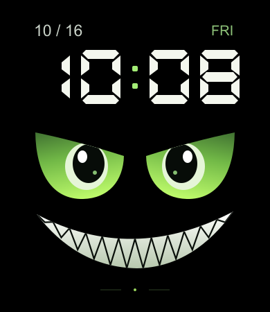

# 夜眸 GT · 表盘作品集

**作者：Yuhui021（余辉021） · BlueOS 方屏表盘 · R7 / 0.1.6**

黑色背景、大号数字时间、绿色动态眼睛与白色尖牙笑脸。已完成开发、安装和基础真机验证，用于展示表盘设计与开发成果。

## 作品预览



*上图为 390 × 450 设计预览，时间固定为 10:08，并非真机照片。安装后显示设备本地时间，眼睛循环眨动。*

## 设计与功能

- 顶部显示日期与星期，大号数字采用 24 小时制。
- 绿色眼睛约每 4.4 秒完成一次眨眼循环，底部为静态尖牙笑脸。
- 亮屏时分钟自动更新；普通息屏后再次唤醒立即同步时间。
- 本版专注时间与动态视觉，无天气、计步、电量等数据项。

## 安装包

**[下载夜眸 GT R7 调试安装包](night-grin-gt-0.1.6-R7-debug.rpk?raw=true)**

| 项目 | 内容 |
| --- | --- |
| 版本 | 0.1.6 / R7（versionCode 7） |
| 格式 | BlueOS 表盘 RPK，调试版 |
| 设计画布 | 390 × 450 |
| 开发目标 | vivo WATCH GT 方屏 |
| 实际测试设备 | iQOO WATCH GT |
| 文件大小 | 205,609 字节 |

此安装包与完成基础真机测试的文件完全一致，可使用 OrbitV 导入并安装至兼容设备。保留原有可用表盘，安装后在本地表盘列表中选择「夜眸 GT R7」。

SHA-256：

```text
8FEADBEF5AA5F3A7A8E3ED79C171C28BBD72EC6E1CF2CD9C267118CF30334B9E
```

## 已完成的验证

2026-10-16，iQOO WATCH GT 真机观察确认：

| 检查项 | 结果 |
| --- | --- |
| 时间、眼睛和牙齿完整显示，宽度正常 | 通过 |
| 绿色眼睛循环眨动 | 通过 |
| 保持亮屏跨分钟，时间自动跳转 | 通过 |
| 息屏跨分钟后唤醒，时间立即正确、眨眼正常 | 通过 |

官方工具构建通过；时间边界、动画资源、页面生命周期和屏幕唤醒恢复等 4 项自动测试通过。真机结果由设备使用者观察确认。

本版用于作品展示与测试，尚未通过社区或官方商店发布审核。其他 vivo WATCH GT、GT 2、WATCH 5 / 6 机型，以及 AOD、长期稳定性和耗电情况尚未验证。

## 设计参考与实现

视觉方向参考轻腕社区[《邪恶之眼（动态）表盘》](https://qingwear.top/post/Duk4qv)。数字字形、眼睛、眼皮与笑脸使用独立编写的矢量几何生成，没有提取参考作品的安装包、图片素材或代码。

本仓库提供作品预览、可安装的测试包和验证说明，不公开开发源码。作品为个人开发测试项目，不代表 vivo 官方作品或认证。
